<div align="center">

# Mag-Null

### Real-Time Passive RF Drone Detection, Classification and Link Analysis

*Detect it. Fingerprint it. Understand how it talks. Without transmitting a single watt.*


</div>

---

## Table of Contents

1. [Overview](#1-overview)
2. [Key Features](#2-key-features)
3. [System Architecture](#3-system-architecture)
4. [How It Works (Stage by Stage)](#4-how-it-works-stage-by-stage)
5. [Supported Protocol Profiles](#5-supported-protocol-profiles)
6. [Dashboard Guide](#6-dashboard-guide)
7. [Installation and Setup](#7-installation-and-setup)
8. [Configuration](#8-configuration)
9. [Running Simulations](#9-running-simulations)
10. [Project Structure](#10-project-structure)
11. [Terminology and Glossary](#11-terminology-and-glossary)
12. [Key Equations](#12-key-equations)
13. [Evaluation](#13-evaluation)
14. [Limitations and Responsible Use](#14-limitations-and-responsible-use)
15. [Roadmap](#15-roadmap)
16. [Contributing](#16-contributing)
17. [License and Author](#17-license-and-author)

---

## 1. Overview

Modern conflicts and security incidents increasingly involve **cheap, small, unmanned drones**. They are hard to spot visually, hard to hear, and often too small for conventional radar. But almost every one of them **must talk to something**: a pilot's controller, a ground station, or a video receiver. That conversation is radio frequency (RF) energy, and it leaves a fingerprint.

**Mag-Null** is a **passive** drone detection system. It never transmits. It only *listens* to the RF environment, converts the signal into the frequency domain with a **512-point FFT pipeline**, and extracts everything it can learn about an incoming drone:

| Question | What Mag-Null reports |
|---|---|
| *Is there a drone?* | Detection event with SNR and timestamp |
| *What kind of drone link is it?* | Protocol class (DJI OcuSync, ELRS, AFHDS, FASST) with a confidence score (about **96%** classification confidence in simulation) |
| *How is it hopping?* | Hop rate, dwell time, hop set, hop-sequence pattern |
| *How fast is it moving?* | Estimated speed / radial velocity from Doppler and signal-strength trends |
| *How does it talk to its receiver?* | Uplink vs downlink structure, packet rate, burst timing, duty cycle |
| *Should I worry?* | Categorised threat level and alerts on a multi-tab dashboard |

> **Simulation-only.** Mag-Null is designed to be fully achievable **without SDR hardware**. A physics-based RF simulator generates realistic IQ samples (drone transmitters + channel + interference), and the *exact same* detection pipeline that would run on live IQ runs on the simulated stream.

### Why "passive"?

| Property | Active (radar) | Passive RF (Mag-Null) |
|---|---|---|
| Emits energy | Yes | **No** |
| Detectable by adversary | Yes | **No** |
| Needs line of sight | Mostly | Not strictly |
| Tells you the control protocol | No | **Yes** |
| Cost | High | Low |
| Works on RF-silent (autonomous) drones | Yes | No (limitation) |

---

## 2. Key Features

- **Passive, receive-only** detection with no emissions.
- **512-point FFT pipeline** with windowing and overlap for real-time spectral analysis.
- **Protocol fingerprinting** for DJI OcuSync, ExpressLRS (ELRS), FlySky AFHDS and Futaba FASST.
- **Frequency-hopping analysis**: hop rate, dwell time, channel set, sequence periodicity.
- **Kinematics estimation**: speed from Doppler shift and range-rate from signal-strength trend.
- **Link analysis**: how the drone talks to its receiver (control uplink, video/telemetry downlink, packet cadence).
- **Multi-tab, categorised dashboard** for operators.
- **Physics-based RF simulator**: path loss, Doppler, multipath fading, AWGN and co-channel interference.
- **Reproducible scenarios**: seedable single-drone, multi-drone and noisy-environment tests.
- **Exportable reports and logs** (JSON / CSV) for analysis and publication.

---

## 3. System Architecture

### 3.1 High-level block diagram

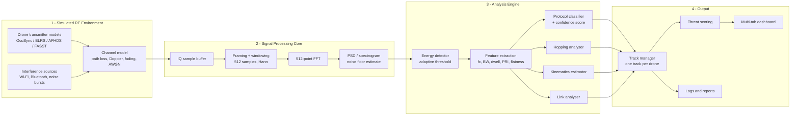

### 3.2 Runtime data flow

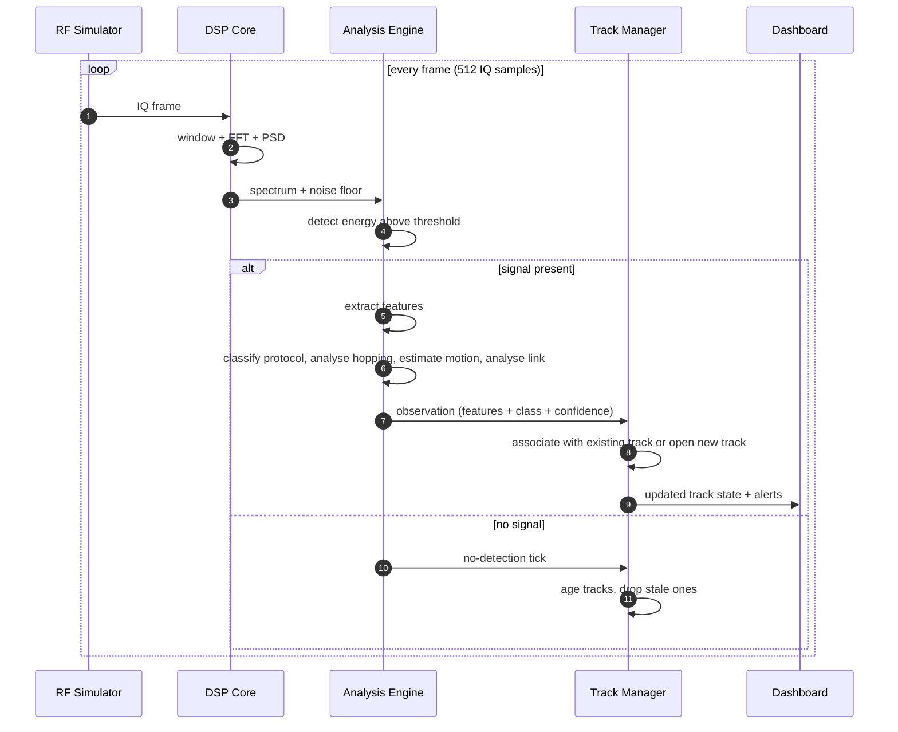

### 3.3 Track lifecycle

Every detected drone becomes a **track**. Tracks move through a small state machine so the dashboard never flickers on a single noisy frame.

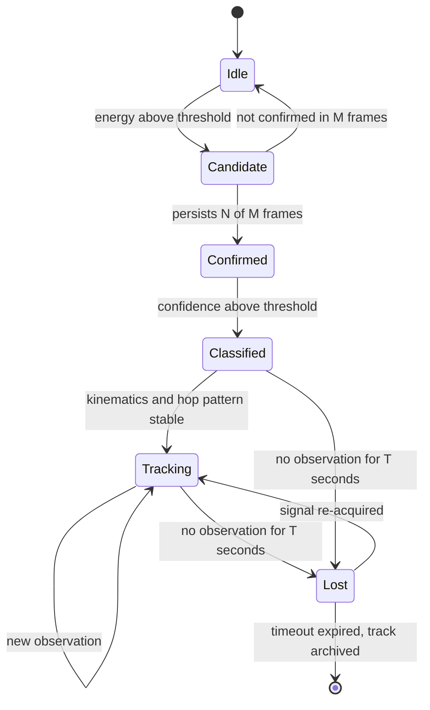

---

## 4. How It Works (Stage by Stage)

### Stage 1 - Simulated RF environment

Because the project runs without SDR hardware, a simulator produces **complex baseband IQ samples** that stand in for what a receiver would capture.

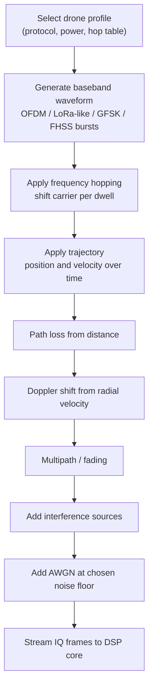

What gets simulated:

| Effect | Why it matters |
|---|---|
| **Path loss** | Signal gets weaker with distance, so SNR tells you something about range |
| **Doppler shift** | A moving drone shifts its carrier slightly, which reveals radial speed |
| **Fading / multipath** | Real signals fluctuate; the detector must not be fooled by dips |
| **AWGN** | Sets the noise floor and limits the minimum detectable signal |
| **Interference** | Wi-Fi and Bluetooth share the 2.4 GHz band and create false-alarm pressure |

### Stage 2 - Framing, windowing and the 512-point FFT

IQ samples arrive as a continuous stream. They are cut into frames of **512 samples**, multiplied by a **window function** (Hann by default) to reduce spectral leakage, and transformed with an FFT.

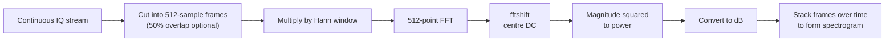

**Frequency resolution** is set by the sampling rate and FFT size:

```
bin width = fs / N
Example: fs = 40 MHz, N = 512  ->  78.125 kHz per bin
```

A bigger N gives finer frequency resolution but coarser time resolution. 512 is a deliberate compromise: fine enough to separate narrow hopping channels, fast enough to catch short bursts and track hops in real time.

### Stage 3 - Detection (is something there?)

Mag-Null estimates the **noise floor** (a running median of the PSD per bin) and raises an **adaptive threshold** above it.

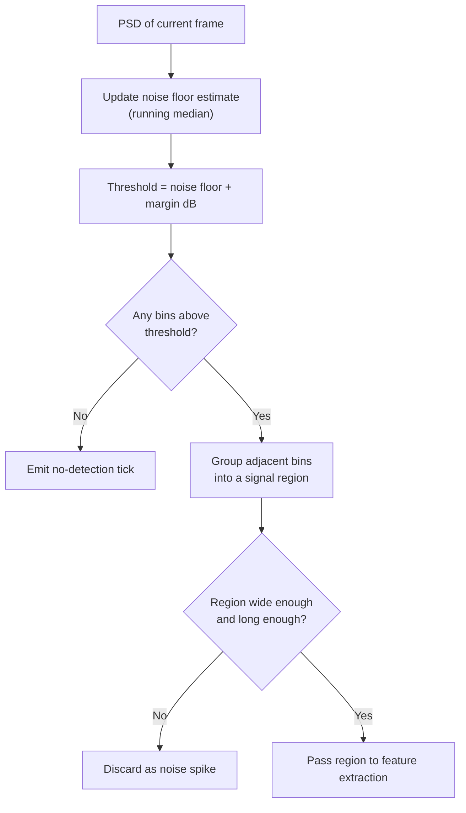

Adaptive thresholds are essential: a fixed threshold either misses weak distant drones or drowns in noise when the environment gets busy.

### Stage 4 - Feature extraction (what does it look like?)

For each detected region the system computes a **feature vector**. These are the numbers the classifier and analysers use.

| Feature | Meaning | Helps distinguish |
|---|---|---|
| Centre frequency (fc) | Middle of the occupied region | Band (2.4 GHz vs 5.8 GHz vs sub-GHz) |
| Occupied bandwidth | Width containing most of the power | Wideband video links vs narrow control links |
| Peak SNR | Strength above the noise floor | Range / proximity |
| Spectral flatness | Noise-like (flat) vs tonal (peaky) | OFDM vs narrowband modulation |
| Burst duration | How long a transmission lasts | Packet structure |
| Pulse repetition interval (PRI) | Time between bursts | Packet rate of the control link |
| Duty cycle | Fraction of time the signal is on | Continuous video vs sparse control |
| Dwell time | Time spent on one hop channel | Hopping behaviour |
| Hop set size | Number of distinct channels used | Protocol channel plan |

### Stage 5 - Protocol classification (what kind of link is it?)

The classifier compares the observed feature vector against a **profile** for each supported protocol and returns a score per class. Scores are normalised into a **confidence**.

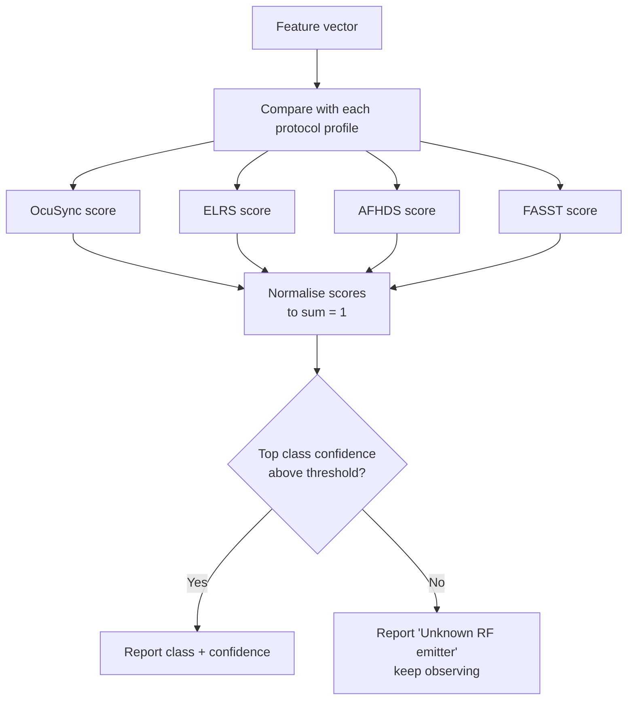

A reference scoring rule (Gaussian similarity per feature, weighted):

```
score_p = sum_i  w_i * exp( -(x_i - mu_{p,i})^2 / (2 * sigma_{p,i}^2) )
confidence_p = score_p / sum_q score_q
```

The classifier is modular: this scoring rule can be replaced with a trained ML model (for example a small CNN on spectrogram patches) without changing the rest of the pipeline.

### Stage 6 - Frequency-hopping analysis

Most hobby and many commercial control links use **frequency-hopping spread spectrum (FHSS)**: they jump between channels many times per second to resist interference and jamming. The hopping analyser turns that behaviour into measurable numbers.

```
Frequency
   ^
f6 |                          ####
f5 |            ####
f4 |                                      ####
f3 |      ####
f2 |                    ####
f1 | ####                                          ####
   +-------------------------------------------------------> Time
     dwell  dwell  dwell  dwell  dwell  dwell  dwell
```

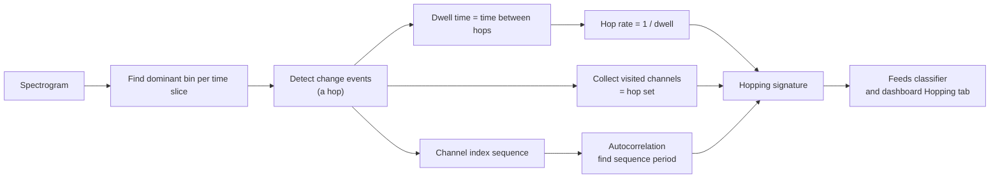

Why it matters: hop rate, hop-set size and sequence period are among the strongest protocol discriminators. A 500 Hz hopper and a 50 Hz hopper are different animals.

### Stage 7 - Kinematics (how fast is it moving?)

Two complementary estimates are fused:

1. **Doppler method.** A drone moving toward or away from the receiver shifts its carrier frequency by a small amount. If the nominal carrier is known from the protocol profile, the measured offset gives **radial speed**.
2. **Signal-strength trend.** Using a path-loss model, a rising or falling received power implies the drone is **closing** or **receding**.

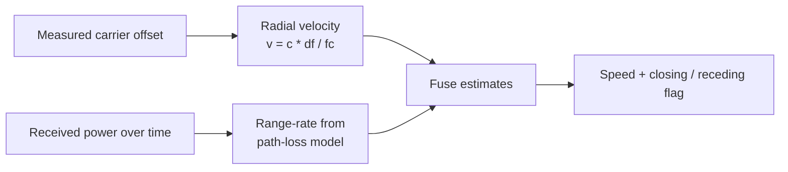

> Passive RF from a single receiver gives **radial** speed and range **trend**, not a full 3D velocity vector. In simulation, ground truth is available, so estimator error can be measured directly.

### Stage 8 - Link analysis (how does it talk to its receiver?)

Drone systems usually have two logical links, and they look very different on a spectrogram:

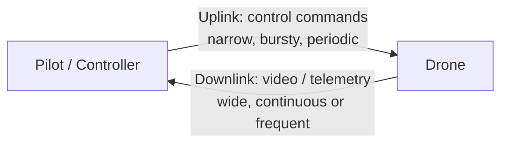

| Link property | Control uplink | Video / telemetry downlink |
|---|---|---|
| Bandwidth | Narrow | Narrow to wide |
| Timing | Periodic bursts (PRI) | Continuous or frequent |
| Duty cycle | Low | High |
| Purpose | Stick inputs, mode changes | Camera feed, battery, GPS |

The link analyser reports packet rate, burst length, duty cycle and whether a reverse (telemetry) channel is present. This is also how Mag-Null distinguishes a *pilot-controlled* link from a one-way beacon.

### Stage 9 - Tracking, threat scoring and output

Observations from all analysers are merged into a **track** per drone. Each track receives a **threat level** from simple, transparent rules (protocol class, closing vs receding, signal strength trend, number of simultaneous emitters) and is displayed on the dashboard and written to logs.

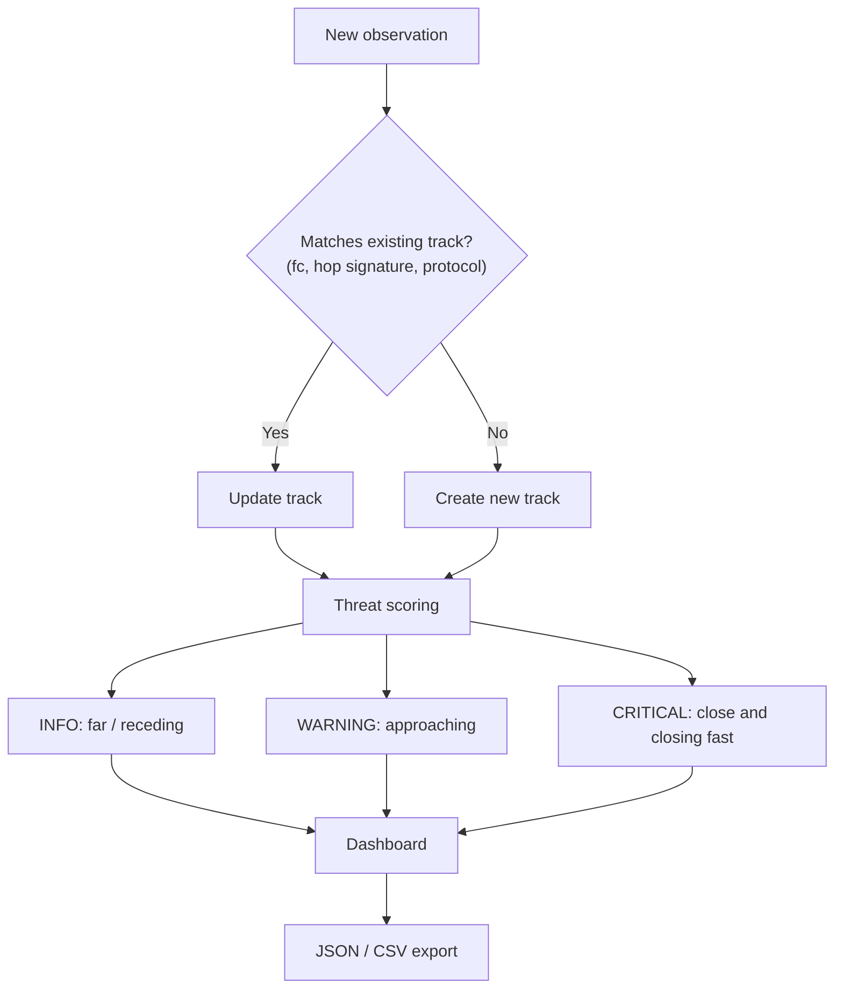

---

## 5. Supported Protocol Profiles

> The values below are **simplified simulation profiles** used to generate and recognise signals. They capture the *character* of each link (band, bandwidth, hopping behaviour), not the exact over-the-air specification of each product. All parameters are editable in `configs/protocols.yaml`.

| Protocol | Typical use | Band(s) | Modulation character | Hopping | Spectral look |
|---|---|---|---|---|---|
| **DJI OcuSync** | Commercial / prosumer DJI drones (control + HD video) | 2.4 GHz and 5.8 GHz | OFDM-like, wide | Adaptive channel selection | Wide, flat-topped block, high duty cycle |
| **ELRS (ExpressLRS)** | FPV and long-range hobby links | 2.4 GHz and sub-GHz (868/915 MHz) | LoRa / FLRC-like chirp or constant-envelope | Fast FHSS, high packet rates | Narrow bursts hopping quickly across many channels |
| **AFHDS** (FlySky) | Hobby RC aircraft and drones | 2.4 GHz | GFSK-like narrowband | FHSS | Narrow hopping carrier, moderate rate |
| **FASST** (Futaba) | Hobby RC aircraft and drones | 2.4 GHz | Narrowband FHSS | FHSS | Narrow hopping carrier, periodic frames |

### Quick visual cheat sheet

```
OcuSync   |██████████████████████|   wide, continuous block
ELRS      |█|  |█|  |█|  |█|        very narrow, very fast hops
AFHDS     |██|    |██|    |██|       narrow, steady hops
FASST     |██|      |██|      |██|   narrow, periodic frames
          -------------------------> frequency / time
```

---

## 6. Dashboard Guide

The dashboard is organised into tabs so an operator can go from "something is out there" to "here is exactly what it is" in a few clicks.

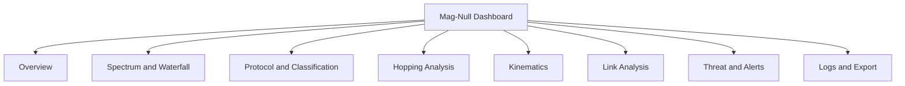

| Tab | What you see |
|---|---|
| **Overview** | Active tracks, count of emitters, highest threat level, system health |
| **Spectrum and Waterfall** | Live PSD, spectrogram/waterfall, detected regions highlighted, noise floor line |
| **Protocol and Classification** | Class per track, confidence bars, feature vector, "why this class" breakdown |
| **Hopping Analysis** | Time-frequency hop plot, hop rate, dwell time, hop set, sequence period |
| **Kinematics** | Estimated radial speed, closing/receding indicator, power-vs-time trend |
| **Link Analysis** | Uplink/downlink separation, packet rate, burst timing, duty cycle |
| **Threat and Alerts** | Threat levels with reasons, alert timeline |
| **Logs and Export** | Event log, scenario metadata, JSON/CSV/PDF export |

---

## 7. Installation and Setup

### 7.1 Prerequisites

| Requirement | Version | Notes |
|---|---|---|
| Python | 3.10 or newer | 3.11 recommended |
| pip | latest | `python -m pip install --upgrade pip` |
| Git | any recent | to clone the repo |
| RAM | 4 GB minimum | 8 GB recommended for multi-drone scenarios |
| GPU | **not required** | everything runs on CPU |
| SDR hardware | **not required** | simulation-only by design |

### 7.2 Setup flow


### 7.3 Step by step

**1. Clone the repository**

```bash
git clone https://github.com/<your-username>/mag-null.git
cd mag-null
```

**2. Create and activate a virtual environment**

```bash
# Linux / macOS
python3 -m venv .venv
source .venv/bin/activate

# Windows (PowerShell)
python -m venv .venv
.venv\Scripts\Activate.ps1
```

**3. Install dependencies**

```bash
pip install --upgrade pip
pip install -r requirements.txt
```

Typical dependencies: `numpy`, `scipy`, `pandas`, `matplotlib`, `plotly`, `pyyaml`, `streamlit` (dashboard), `pytest` (tests).

**4. Verify the install**

```bash
pytest -q
```

All tests should pass. If a test fails, check your Python version first.

**5. Run your first simulation**

```bash
python -m magnull.run --scenario scenarios/single_drone_ocusync.yaml
```

You should see frames being processed and a detection summary printed to the console.

**6. Launch the dashboard**

```bash
streamlit run magnull/dashboard/app.py
```

Open the URL shown in the terminal (usually `http://localhost:8501`).

### 7.4 Troubleshooting

| Symptom | Likely cause | Fix |
|---|---|---|
| `ModuleNotFoundError` | Virtual env not active | Re-activate `.venv` and reinstall |
| Dashboard is blank | Simulation not started | Start a scenario from the sidebar or the CLI first |
| Sluggish waterfall | Too many drones / too high sample rate | Lower `sample_rate_hz` or `num_drones` in the scenario |
| No detections | Threshold margin too high / SNR too low | Reduce `detector.margin_db` or raise drone TX power |
| Many false alarms | Interference too strong / margin too low | Increase `detector.margin_db`, require more confirm frames |

---

## 8. Configuration

All behaviour is controlled through YAML files in `configs/` and `scenarios/`.

### 8.1 Core pipeline (`configs/default.yaml`)

```yaml
dsp:
  sample_rate_hz: 40_000_000     # complex sampling rate
  fft_size: 512                  # FFT length (bin width = fs / N)
  window: hann                   # hann | hamming | blackman | rect
  overlap: 0.5                   # 0.0 - 0.9

detector:
  noise_floor_method: running_median
  margin_db: 8.0                 # threshold above noise floor
  confirm_frames: [3, 5]         # N of M confirmation rule
  min_bandwidth_hz: 100_000
  min_duration_ms: 1.0

classifier:
  method: signature              # signature | ml
  min_confidence: 0.70           # below this -> "Unknown RF emitter"

tracking:
  lost_timeout_s: 2.0
  archive_timeout_s: 10.0

threat:
  closing_speed_warn_mps: 5.0
  closing_speed_critical_mps: 15.0
  snr_critical_db: 30.0
```

### 8.2 Scenario file (`scenarios/multi_drone_mixed.yaml`)

```yaml
name: multi_drone_mixed
seed: 42
duration_s: 30

environment:
  noise_floor_dbm: -95
  interference:
    - type: wifi
      channel: 6
      duty_cycle: 0.3
    - type: bluetooth
      duty_cycle: 0.1

drones:
  - id: drone_a
    protocol: ocusync
    tx_power_dbm: 20
    trajectory:
      start_m: [800, 0, 60]
      velocity_mps: [-12, 0, 0]       # approaching
  - id: drone_b
    protocol: elrs
    tx_power_dbm: 14
    trajectory:
      start_m: [300, 200, 40]
      velocity_mps: [3, -2, 0]
```

### 8.3 Protocol profiles (`configs/protocols.yaml`)

```yaml
ocusync:
  band_hz: [2.4e9, 5.8e9]
  bandwidth_hz: 10_000_000
  hopping: adaptive
  duty_cycle: 0.9

elrs:
  band_hz: [2.4e9, 915e6]
  bandwidth_hz: 500_000
  hop_rate_hz: 500
  hop_set_size: 80
  duty_cycle: 0.1
```

---

## 9. Running Simulations

### 9.1 Built-in scenarios

| Scenario | Purpose |
|---|---|
| `single_drone_ocusync.yaml` | Baseline: one wideband DJI-style link |
| `single_drone_elrs.yaml` | Fast-hopping narrowband link |
| `multi_drone_mixed.yaml` | Several protocols at once, tests track separation |
| `noisy_urban.yaml` | Heavy Wi-Fi/Bluetooth interference, tests false alarms |
| `low_snr_far.yaml` | Weak, distant drone, tests detection limits |
| `fly_by.yaml` | Drone approaches and departs, tests Doppler and threat transitions |

### 9.2 Common commands

```bash
# Run a scenario headless and save results
python -m magnull.run --scenario scenarios/multi_drone_mixed.yaml --out results/run1

# Override a parameter from the command line
python -m magnull.run --scenario scenarios/fly_by.yaml --set detector.margin_db=10

# Run the evaluation suite over many random seeds
python -m magnull.evaluate --scenarios scenarios/ --seeds 50 --out results/eval

# Launch the dashboard
streamlit run magnull/dashboard/app.py
```

### 9.3 Output files

```
results/run1/
├── tracks.json         # every track with features, class, confidence
├── events.csv          # time-ordered detections and alerts
├── spectrogram.npy     # raw spectrogram (optional)
├── metrics.json        # per-run metrics
└── report.pdf          # summary report (optional)
```

---

## 10. Project Structure

```
mag-null/
├── configs/
│   ├── default.yaml            # DSP, detector, classifier, tracking, threat
│   └── protocols.yaml          # protocol profiles
├── scenarios/                  # simulation scenarios (YAML)
├── magnull/
│   ├── simulator/              # transmitters, trajectories, channel, interference
│   ├── dsp/                    # framing, windowing, FFT, PSD, noise floor
│   ├── detection/              # adaptive threshold, region grouping
│   ├── features/               # feature extraction
│   ├── classification/         # signature scorer, optional ML model
│   ├── hopping/                # hop detection and sequence analysis
│   ├── kinematics/             # Doppler + power-trend estimation
│   ├── link/                   # uplink/downlink analysis
│   ├── tracking/               # track manager, lifecycle
│   ├── threat/                 # threat scoring rules
│   ├── dashboard/              # multi-tab UI
│   ├── run.py                  # CLI entry point
│   └── evaluate.py             # batch evaluation
├── tests/
├── docs/                       # extra diagrams and notes
├── requirements.txt
└── README.md
```

---

## 11. Terminology and Glossary

### Signals and RF basics

| Term | Plain-English meaning |
|---|---|
| **RF (Radio Frequency)** | Electromagnetic waves used for wireless communication, from kHz up to many GHz |
| **Carrier / centre frequency (fc)** | The main frequency a signal is built around |
| **Bandwidth (BW)** | How much frequency space a signal occupies |
| **Occupied bandwidth** | The width that contains most (for example 99%) of the signal power |
| **ISM band** | License-free bands (2.4 GHz, 5.8 GHz, 915 MHz...) shared by Wi-Fi, Bluetooth, drones and more |
| **Noise floor** | The background level of noise; signals must rise above it to be seen |
| **SNR (Signal-to-Noise Ratio)** | How far a signal sits above the noise floor, in dB |
| **dB / dBm** | Logarithmic power units; dBm is dB relative to 1 milliwatt |
| **RSSI** | Received Signal Strength Indicator, a measure of received power |
| **AWGN** | Additive White Gaussian Noise, the standard random noise model |
| **Path loss** | Weakening of a signal as it travels through space |
| **Multipath / fading** | Signal copies arriving via different paths that add and cancel, causing fluctuations |
| **Doppler shift** | Small change in frequency caused by relative motion |

### Sampling and spectral analysis

| Term | Plain-English meaning |
|---|---|
| **IQ samples (I/Q)** | Complex numbers (In-phase + Quadrature) that fully describe a signal around a centre frequency |
| **Baseband** | A signal shifted down so its centre sits at 0 Hz, convenient for processing |
| **Sampling rate (fs)** | Number of IQ samples per second; sets the visible frequency span |
| **FFT (Fast Fourier Transform)** | Algorithm that converts samples over time into frequency content |
| **FFT size (N)** | Number of samples per transform (512 here) |
| **FFT bin** | One frequency slot of width fs / N |
| **Window function** | A taper (such as Hann) applied before the FFT to reduce spectral leakage |
| **Spectral leakage** | Energy smearing across bins because the signal does not fit the frame exactly |
| **PSD (Power Spectral Density)** | Power per unit frequency; what you plot as the spectrum |
| **Spectrogram / waterfall** | PSD stacked over time, showing how the spectrum evolves |
| **Spectral flatness** | How noise-like (flat) versus tonal (peaky) a spectrum is |

### Modulation and protocol terms

| Term | Plain-English meaning |
|---|---|
| **Modulation** | How data is encoded onto a carrier |
| **OFDM** | Many narrow subcarriers transmitted in parallel; looks like a wide flat block |
| **GFSK** | Gaussian frequency-shift keying; a smooth, narrowband modulation |
| **LoRa / FLRC** | Chirp-based and constant-envelope modulations used for long-range links |
| **FHSS** | Frequency-Hopping Spread Spectrum; rapidly jumping between channels |
| **Hop set** | The set of channels a hopper uses |
| **Hop sequence** | The order in which channels are visited |
| **Hop rate** | Hops per second |
| **Dwell time** | Time spent on one channel before hopping (1 / hop rate) |
| **Burst** | A short transmission |
| **PRI (Pulse Repetition Interval)** | Time between consecutive bursts |
| **Duty cycle** | Fraction of time a transmitter is on |
| **Uplink** | Controller to drone (commands) |
| **Downlink** | Drone to controller (video, telemetry) |
| **Telemetry** | Status data sent back from the drone (battery, GPS, attitude) |
| **FPV (First-Person View)** | Flying with a live camera feed, usually over a wideband video downlink |

### Detection and system terms

| Term | Plain-English meaning |
|---|---|
| **Passive detection** | Detecting by listening only, with no transmission |
| **Counter-UAS (C-UAS)** | Systems and methods that detect, track and respond to unmanned aircraft |
| **Protocol fingerprint** | The combination of features that uniquely characterise a link type |
| **Confidence** | The classifier's normalised score for its top class |
| **Adaptive threshold** | A detection threshold that follows the changing noise floor |
| **Track** | A persistent record of one detected drone over time |
| **False positive / false negative** | Alarm with no drone / missed drone |
| **Precision / recall** | Fraction of alarms that were real / fraction of real drones that were found |
| **SDR (Software-Defined Radio)** | Programmable radio hardware; **not used here**, replaced by the simulator |
| **Dual-use** | Technology useful for both civilian and defence applications |

---

## 12. Key Equations

GitHub renders the maths below.

**Frequency resolution (FFT bin width)**

$$\Delta f = \frac{f_s}{N}$$

**Power spectrum in dB**

$$P_{dB}[k] = 10 \log_{10}\left(\left|X[k]\right|^2\right)$$

**Signal-to-noise ratio**

$$\mathrm{SNR_{dB}} = P_{signal,dB} - P_{noise,dB}$$

**Free-space path loss** (d in km, f in MHz)

$$\mathrm{FSPL_{dB}} = 32.44 + 20\log_{10}(d_{km}) + 20\log_{10}(f_{MHz})$$

**Doppler shift** (radial velocity $v_r$, carrier $f_c$, speed of light $c$)

$$f_D = \frac{v_r}{c} f_c \quad\Rightarrow\quad v_r = \frac{c \, f_D}{f_c}$$

**Dwell time and hop rate**

$$T_{dwell} = \frac{1}{R_{hop}}$$

**Duty cycle**

$$D = \frac{T_{on}}{T_{on} + T_{off}}$$

**Worked example.** At $f_c = 2.4$ GHz, a drone approaching at 20 m/s produces a Doppler shift of about $20 / (3\times10^8) \times 2.4\times10^9 = 160$ Hz. With 78.125 kHz bins that is far below one bin, so Doppler is estimated by tracking sub-bin carrier offsets (for example by interpolating the spectral peak over many frames), not by reading a single bin.

---

## 13. Evaluation

Because the system is simulation-based, ground truth is always known, which allows rigorous measurement.

| Metric | Definition |
|---|---|
| Detection probability (Pd) | Fraction of drone-present frames/events correctly detected |
| False-alarm rate | False detections per minute with no drone present |
| Classification accuracy / confidence | Correct protocol label rate and mean top-class confidence |
| Hop-rate error | |estimated hop rate - true hop rate| / true hop rate |
| Speed error | |estimated radial speed - true radial speed| |
| Time to first detection | Delay between drone appearing and a confirmed track |
| Track purity | Fraction of a track's observations that belong to one real drone |

Headline result: Mag-Null reaches about **96% classification confidence** across the supported protocols in simulation. Reproduce and extend this with:

```bash
python -m magnull.evaluate --scenarios scenarios/ --seeds 50 --out results/eval
```

Report results per SNR level, per protocol, and per interference condition so claims are transparent about where the system is strong and where it degrades.

---

## 14. Limitations and Responsible Use

**Limitations**

- **Simulation-only.** Results come from a physics-based simulator. Real-world RF (antenna patterns, terrain, receiver imperfections, unusual firmware) will be messier, so field validation is future work.
- **Simplified protocol profiles.** Profiles model each protocol's character, not its exact specification.
- **RF-silent drones.** Autonomous drones that emit nothing are invisible to any passive RF detector.
- **Single-receiver geometry.** One receiver gives radial speed and range trend, not full position or 3D velocity.
- **Unknown protocols.** Unfamiliar links are reported as "Unknown RF emitter" rather than forced into a class.

**Responsible use**

Mag-Null is a **receive-only, defensive** detection and research tool. It does not transmit, jam, spoof or interfere with any link. Use it only in accordance with local laws and regulations, and do not use it to track or surveil people without authority.

---

## 15. Roadmap

- [ ] Replace the signature scorer with a trained spectrogram CNN and compare
- [ ] Add more protocol profiles (for example Crossfire, FrSky, Wi-Fi based drones)
- [ ] Multi-receiver simulation for direction finding and localisation (TDOA / AoA)
- [ ] Swarm scenarios with many simultaneous emitters
- [ ] Recorded-IQ playback mode for future real-capture validation
- [ ] Exportable PDF operator reports
- [ ] Docker image for one-command setup

---

## 16. Contributing

Contributions, issues and ideas are welcome.

1. Fork the repository
2. Create a feature branch: `git checkout -b feature/my-improvement`
3. Add tests for your change and run `pytest -q`
4. Commit with a clear message and open a pull request

Please keep new DSP and detection code covered by tests with fixed random seeds so results stay reproducible.

---

## 17. License and Author

Released under the **MIT License** (replace with your chosen license and add a `LICENSE` file).

**Author:** Harsh Prabhakar

If you use Mag-Null in academic work, please cite it:

```bibtex
@software{magnull,
  author  = {Prabhakar, Harsh},
  title   = {Mag-Null: Real-Time Passive RF Drone Detection},
  year    = {2026},
  url     = {https://github.com/<your-username>/mag-null}
}
```

<div align="center">

*Mag-Null: listen quietly, detect early.*

</div>
